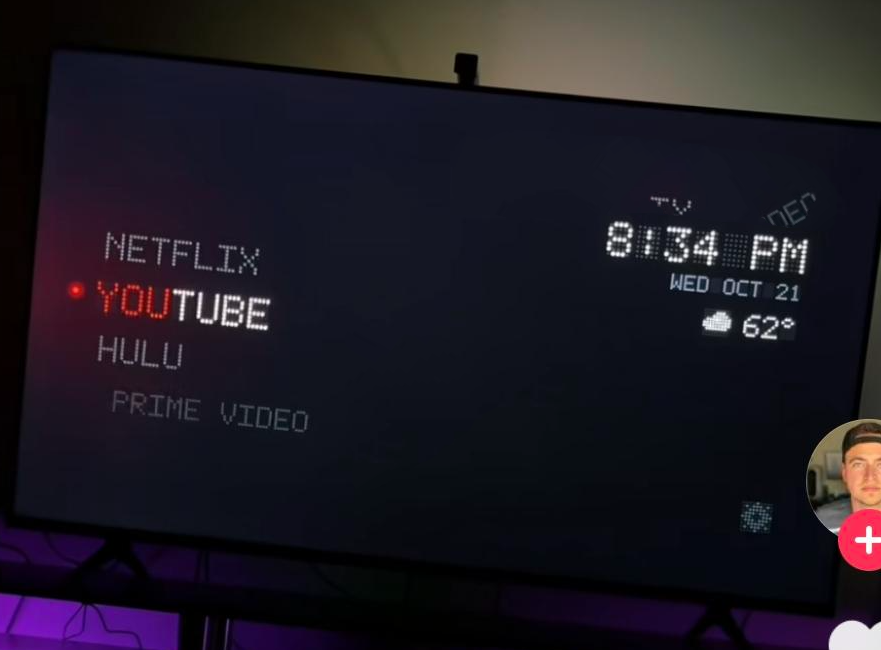
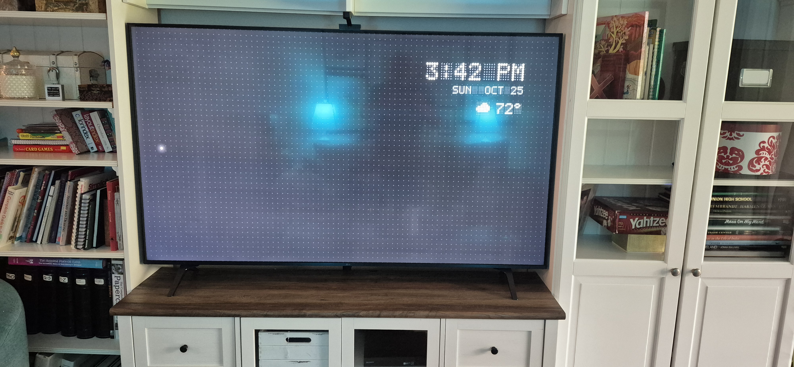

# CleanYourTV Wheel Launcher

A dot-matrix "wheel" home screen for rooted LG webOS TVs running
[CleanYourTV for webOS](https://github.com/lasharor/cleanyourtv-WebOS) — a
drop-in replacement for its own launcher page, built by porting the WHEEL mode
from [Seeker TV Launcher](https://github.com/TWBankston/Seeker-TV-Launcher)
(originally for Android/Google TV) to run as a webOS web app.

| The inspiration | Running on the TV |
|---|---|
|  |  |

Your app names scroll on a vertical dot-matrix wheel, colour-matched to each
app's own icon. Clock, date and weather sit top-right. No tiles, no grid, no
ads — just the apps you actually use.

## What it does

- **Wheel navigation** — Up/Down spins the list, OK launches, Right/Left reach
  a Settings shortcut and back.
- **Per-app colour**, sampled from each app's real icon (same method
  CleanYourTV's own stock launcher uses, so it looks consistent).
- **Clock, date, weather** — [Open-Meteo](https://open-meteo.com/), no API key,
  fixed to a location you set once.
- **Hold OK on an app** for a small menu: **MOVE** (reorder), **HIDE** (pull it
  off the wheel), **RENAME** (shorten a long app title), **CANCEL**.
- **Hidden apps** collect behind a "HIDDEN (n)" entry at the end of the wheel —
  select it, then OK any app there to bring it back.
- Debounced scrolling, so a fast run of key presses advances one step at a
  time instead of jumping straight to wherever the last press lands — written
  with an accessibility use case in mind (a user who finds a fast-animating
  list hard to track).

## What it doesn't do

This replaces CleanYourTV's own launcher page entirely, so you lose a few of
its stock features: the tile grid, the "running apps" list on Back, Live TV,
and the dock/top-bar customisation menu. Everything else CleanYourTV does
(ad/telemetry debloat, the Input key, SSH) is untouched — this only swaps the
home screen's look.

## Before you start

This assumes your TV is **already rooted** with the
[Homebrew Channel](https://webosbrew.org) and running
[CleanYourTV for webOS](https://github.com/lasharor/cleanyourtv-WebOS) as your
Home launcher. If you haven't done that yet, start with CleanYourTV's own
[install guide](https://lasharor.github.io/cleanyourtv-WebOS/install/) —
rooting a TV carries real risk (a method that works today may not tomorrow,
and there's no guaranteed recovery path if something goes wrong on your
specific model). Take a backup of your TV's storage before doing any of this,
and read what you're running before you run it.

## Installing

1. **Set your weather location** in `launcher/index.html` before copying it
   over — look up your coordinates at
   `https://geocoding-api.open-meteo.com/v1/search?name=<your city>`, or for a
   US zip code, `http://api.zippopotam.us/us/<zip>`:
   ```js
   var LAT = 0, LON = 0;  // <-- change this
   ```
2. **Copy the launcher page** over CleanYourTV's own, then re-stage and reload
   Home:
   ```sh
   scp launcher/index.html root@<tv-ip>:/media/developer/cleanyourtv/app/index.html
   ssh root@<tv-ip> 'sh /media/developer/cleanyourtv/stage-home.sh && sh /media/developer/cleanyourtv/reload-home.sh'
   ```
3. **Apply the two small backend patches** (`patches/config.js` and
   `patches/apps.js`), which add support for remembering a full custom app
   order and per-app renamed labels — CleanYourTV's own config schema only
   has room for a 4-item dock, not a full reorder of everything. Each file is
   CleanYourTV's stock file with one small, clearly-commented addition; diff
   against your installed version if it's since been updated upstream:
   ```sh
   scp patches/config.js root@<tv-ip>:/media/developer/cleanyourtv/config.js
   scp patches/apps.js root@<tv-ip>:/media/developer/cleanyourtv/apps.js
   ssh root@<tv-ip> 'pkill -f "[c]leanyourtv/helper.js"; sleep 1; nohup node /media/developer/cleanyourtv/helper.js >/tmp/cleanyourtv-helper.log 2>&1 </dev/null &'
   ```

Reverting is the same as reverting CleanYourTV itself: `sh
/media/developer/cleanyourtv/uninstall.sh` on the TV restores LG's stock Home
completely.

## Known rough edges

- The wheel's step animation duration and its input debounce are both tuned in
  `launcher/index.html` (`.app`'s CSS `transition` and `STEP_MS`) — they're
  kept in sync so a step always finishes before the next is accepted, but feel
  free to retune both for your own remote/eyesight.
- `POST /api/config` on CleanYourTV's backend replaces `hidden`/`order`/`names`
  as one group on every call — this launcher already accounts for that
  (`saveLauncherState()` always sends all three together), but keep it in mind
  if you extend it further.
- Renaming relies on webOS's own on-screen keyboard; different webOS versions
  may signal "done" differently (blur vs. a change event vs. neither) — both
  are handled, but a third behaviour might not be.

## Credits & license

MIT — see [LICENSE](LICENSE). Built on top of
[CleanYourTV for webOS](https://github.com/lasharor/cleanyourtv-WebOS) (MIT)
and ports the WHEEL mode design from
[Seeker TV Launcher](https://github.com/TWBankston/Seeker-TV-Launcher) (MIT).
See [THIRD-PARTY.md](THIRD-PARTY.md) for exactly what's ported from where, and
both original license texts in full. Not affiliated with either project or
with LG.
